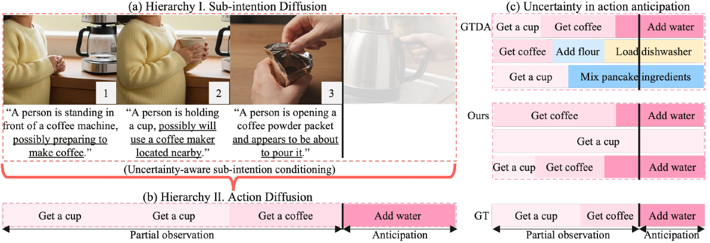
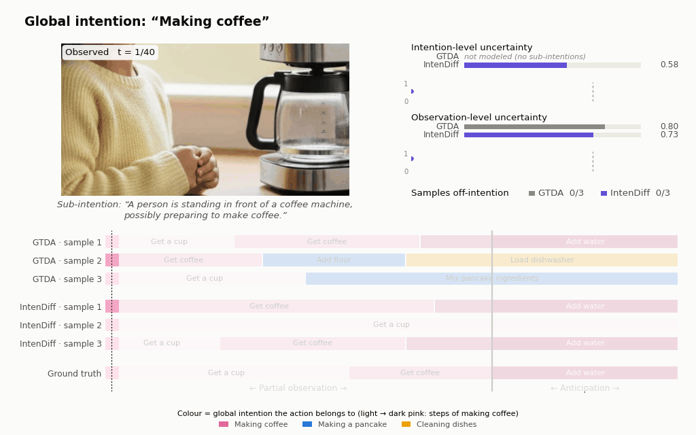

<div align="center">

<h1>Intent Makes the Difference: Intention Diffusion for Action Anticipation</h1>

<div>
    <a href='https://skvictoria.github.io' target='_blank'>Seulgi Kim</a>, Mohit Prabhushankar,
    <a href='https://alregib.ece.gatech.edu/' target='_blank'>Ghassan AlRegib</a>
</div>
<div>
    Georgia Institute of Technology (<a href='https://alregib.ece.gatech.edu/' target='_blank'>OLIVES Lab</a>)
</div>

<div align="center">
    <h3>
        <b>Published at WACV 2027</b>
    </h3>
    <!-- <p>
        [<a href="https://arxiv.org/abs/2605.01967" target='_blank'><b>Read the Paper Here</b></a>]
    </p> -->
</div>

<div style="text-align:center">

</div>

<div style="text-align:center">

<p><i>Animated version of Fig. 1: sub-intentions evolve with the observed frames, and IntenDiff's action samples stay within the global intention while GTDA's drift to other intentions. Uncertainty values are illustrative, not model outputs.</i></p>
</div>

---

</div>

**Abstract**

Action anticipation predicts future actions from partially observed videos. Because observations are limited, it requires inferring hidden intentions, leading to two uncertainties: (1) \textit{observation-level uncertainty} from partial or noisy visual evidence, and (2) \textit{intention-level uncertainty} because the same observation can imply multiple plausible future intentions. Prior work largely models only observation-level uncertainty, limiting long-horizon anticipation where unobserved, evolving intentions drive behavior.
We introduce \textsc{IntenDiff}, a hierarchical diffusion framework that explicitly models intention-level uncertainty via \textbf{sub-intentions}: temporally evolving short-term intentions that bridge the video’s \textit{global intention} and future actions. (1) Sub-Intention Diffusion starts from the global intention and stochastically samples sub-intention embeddings over time in a label-free manner. We ground these embeddings in language by co-fine-tuning with a vision--language model (VLM) using a contrastive alignment loss, producing multiple, linguistically coherent hypotheses beyond the visible frames. (2) Action Diffusion generates actions conditioned on sampled sub-intentions via uncertainty-aware conditioning, adaptively assigning higher weight to time segments where sub-intentions remain aligned with the global intention. By jointly capturing intention-level and observation-level uncertainty, \textsc{IntenDiff} yields intention-consistent and robust long-horizon predictions under partial observability. Empirically, \textsc{IntenDiff} achieves consistent gains across six benchmarks, advancing the state-of-the-art.


## Folder structure

```
causdiff-main/
├── src/                     # All Python code (flat imports — keep files at this level)
│   ├── main_causal_hierarchical.py  # IntenDiff entry point (--variant, --dataset)
│   ├── main.py, main-causal.py      # older baselines
│   ├── trainers*.py, models*.py, bit_diffusion*.py, batch_gen*.py, qwen*.py ...
│   ├── analysis/            #   uncertainty / attention / AUUC analysis scripts
│   ├── tools/               #   standalone utilities (qwen sub-intention extractor, npy/spectrum tools)
│   └── llm_as_a_judge/      #   VLM-as-a-judge evaluation scripts
├── scripts/
│   ├── prob/                # train/predict configs (probabilistic models)
│   ├── determ/              # train/predict configs (deterministic models)
│   └── slurm/               # sbatch launchers (run*.sh, test*.sh)
├── archive/src/             # unused experiment variants (see archive/README.md)
├── datasets/                # mappings, splits, ground truth, preprocessing scripts
│   └── darai/gt_sub_intention/   # GT sub-intentions (from llm_as_a_judge/parse_gt_sub_intention.py)
├── logs/                    # (local only, gitignored) slurm-*.out logs + INDEX.md
├── outputs/                 # (local only, gitignored)
│   ├── uncertainty_attention_out*/   # uncertainty vs. attention plots & summaries
│   └── llm_as_a_judge/               # idefics / llava / local-VLM judge results
└── notebooks/
    └── slurm_launcher.ipynb # sbatch / scancel cells
```

## Data
- Breakfast: Download ground-truth labels from the original dataset sources and place them under `datasets/breakfast/groundTruth/`

- EGTEA+: Download ground-truth labels from the original dataset sources and place them under `datasets/egtea/groundTruth/`

- UTKinects: Download ground-truth labels from the original dataset sources and place them under `datasets/utkinects/groundTruth/`

- NTURGBD: Download ground-truth labels from the original dataset sources and place them under `datasets/nturgbd/groundTruth/`

- DARai: Download ground-truth labels from here (https://ieee-dataport.org/open-access/darai-daily-activity-recordings-ai-and-ml-applications) and place them under `datasets/darai/groundTruth/`

## Running

Always run from the repo root (scripts use `./src` and `./datasets` paths):

```bash
sbatch scripts/slurm/run-causal-hierarchical.sh
```

New slurm logs go to `logs/slurm/slurm-<jobid>_<jobname>.out` automatically.
After adding logs, regenerate `logs/slurm/INDEX.md` if you want the summary up to date.

### Variants and datasets

`src/main_causal_hierarchical.py` picks the model and data loader by flag:

| `--variant` | VLM encoder | code path |
|---|---|---|
| `base` | Qwen2-VL-7B (online encoder) | `trainers_causal_hierarchical` → `bit_diffusion_causal_hierarchical_qwen` |
| `projector` | Qwen2-VL-7B, LoRA + trainable mm-projector | same, with `projector=True` |
| `lora_qwen2vl_2b` | Qwen2-VL-2B, LoRA | `trainers_causal_hierarchical_onlylora` → `bit_diffusion_causal_hierarchical_qwen_onlylora` |
| `lora_qwen2vl_7b` | Qwen2-VL-7B, LoRA, alpha-gated goal fusion | `trainers_causal_hierarchical_lora` → `bit_diffusion_causal_hierarchical_qwen_lora` |
| `lora_qwen25vl_3b` | Qwen2.5-VL-3B, LoRA | same, `vlm='qwen25vl_3b'` |
| `lora_qwen25vl_7b` | Qwen2.5-VL-7B, LoRA | same, `vlm='qwen25vl_7b'` |

- `--dataset`: `darai_l3`, `darai_l2`, `utkinects`, `nturgbd`, `breakfast`, `50salads`.
- `--goal_set`: global-goal texts (`src/goals.py`). Defaults to the one matching `--dataset`;
  set it explicitly to override (e.g. `egtea`).
- `--num_samples` defaults to 1 for `base`/`projector` and 5 otherwise.
- `--ds` is unchanged and only affects the experiment directory name.

Shared code: `bit_diffusion_common.py` (noise schedule, q-sampling, losses),
`qwen_lora_encoder.py` (LoRA VLM encoder; prompts/resolution per preset), `goals.py`.


## Demo video

The GIF above is built from Fig. 1 itself (illustrative uncertainty curves):
```bash
python src/tools/make_fig1_demo.py imgs/figure1.pdf /tmp/fig1_demo   # needs poppler's pdfimages
python src/tools/make_demo_video.py /tmp/fig1_demo -o imgs/intendiff-demo.gif --fps 5 --hold 15
```

For a demo from real model outputs, `src/tools/make_demo_video.py` renders a GIF/MP4 of one test video: the video plays with the
intention-level (Eq. 2) and observation-level uncertainty bars evolving on the top right, and the
sampled future actions (as in Fig. 1c) revealed below.

1. Run any `lora_*` predict script with two extra flags (on the GPU node):
   ```bash
   python ./src/main_causal_hierarchical.py --variant=lora_qwen2vl_7b --dataset=darai_l3 $OPTS \
       --demo_dir=./outputs/demo --demo_max=5
   ```
   Each saved video gets `outputs/demo/<video>_obs<rate>/` (frames, action samples, sub-intentions, VLM anchors).
2. Render (CPU is fine):
   ```bash
   python src/tools/make_demo_video.py outputs/demo/<video>_obs0.3 -o imgs/demo.gif --mp4 imgs/demo.mp4
   ```

---

## Citation


```bibtex
@inproceedings{kim2027intent,
    title={Intent Makes the Difference: Intention Diffusion for Action Anticipation},
    author={Kim, Seulgi and Prabhushankar, Mohit and AlRegib, Ghassan},
    booktitle={IEEE/CVF Winter Conference on Applications of Computer Vision},
    year={2027}
}
```


## Acknowledgement
This codebase is adapted from the  **[GTDA framework](https://github.com/olga-zats/GTDA)**. We sincerely thank the authors for open-sourcing their code.
